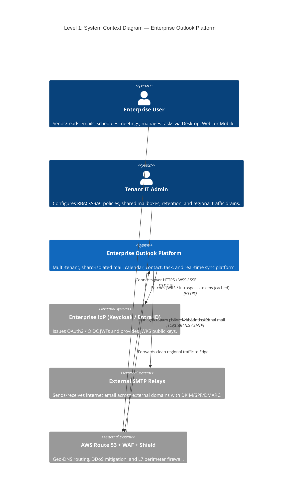
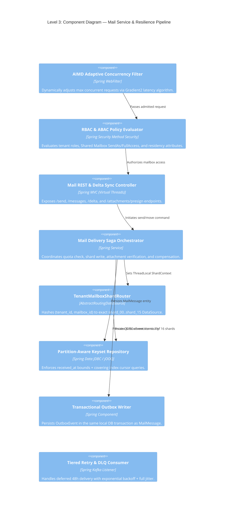
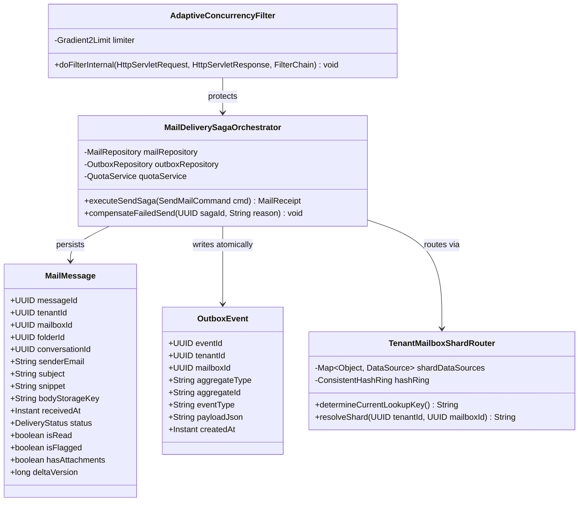

# Enterprise Microsoft Outlook Platform — Distributed System Design & Spring Boot Implementation

[](https://openjdk.org/projects/jdk/21/)
[](https://spring.io/projects/spring-boot)
[](https://spring.io/projects/spring-cloud)
[-336791.svg)](https://www.postgresql.org/)
[](https://kafka.apache.org/)
[](https://kubernetes.io/)
[](https://www.terraform.io/)

A hyper-scale, multi-tenant **Enterprise Microsoft Outlook Platform** built with **Java 21 (Virtual Threads)**, **Spring Boot 3.4+**, **Spring Cloud**, **PostgreSQL 16 (16 Logical Shards + Time-Range Partitioning)**, **Apache Kafka**, **Debezium CDC**, **Redis Cluster**, **OpenSearch**, and **MinIO/S3**.

This architecture is explicitly engineered to prevent the **November 12–13, 2026 Microsoft Exchange Online / Outlook Global Cascading Outage** by incorporating decoupled stale-while-revalidate authentication, isolated liveness/readiness probes, Envoy slow-start warm-up and panic floors, AIMD adaptive concurrency limiting, and store-and-forward deferred delivery queues.

---

## Table of Contents

1. [End-to-End Architecture Workflow](#1-end-to-end-architecture-workflow)
2. [HLD & LLD — The Four C's (C4 Model Levels of Abstraction)](#2-hld--lld--the-four-cs-c4-model-levels-of-abstraction)
3. [Microservices & Edge Evaluation (6 Core Parameters)](#3-microservices--edge-evaluation-6-core-parameters)
4. [Sequential Local Startup Guide (Step-by-Step)](#4-sequential-local-startup-guide-step-by-step)
5. [AWS Edge & Perimeter Configuration (Route 53, WAF/Shield, CloudFront)](#5-aws-edge--perimeter-configuration-route-53-wafshield-cloudfront)
6. [Terraform Infrastructure-as-Code (IaC) Deep Dive & Beginner Guide](#6-terraform-infrastructure-as-code-iac-deep-dive--beginner-guide)
7. [Kubernetes Manifests & Internal Mechanics Walkthrough](#7-kubernetes-manifests--internal-mechanics-walkthrough)
8. [Java Microservices Design Patterns & Deep-Dive Comparisons](#8-java-microservices-design-patterns--deep-dive-comparisons)
   - [API Gateway with Rate Limiting](#81-api-gateway-with-rate-limiting)
   - [JWT + OAuth2/OIDC Authentication (with Outage Fallback)](#82-jwt--oauth2oidc-authentication-with-outage-fallback)
   - [RBAC & ABAC Authorization](#83-rbac--abac-authorization)
   - [Eureka Server (Service Discovery)](#84-eureka-server-service-discovery)
   - [Saga Pattern with Transactional Outbox & Debezium CDC](#85-saga-pattern-with-transactional-outbox--debezium-cdc)
   - [Transactional Outbox vs. Debezium CDC (Architectural Decision Matrix)](#86-transactional-outbox-vs-debezium-cdc-architectural-decision-matrix)
   - [CQRS Pattern](#87-cqrs-pattern)
   - [Circuit Breaker, Bulkhead & Adaptive Load Shedding](#88-circuit-breaker-bulkhead--adaptive-load-shedding)
   - [Failed Case Flow & SAGA Compensation Trace](#89-failed-case-flow--saga-compensation-trace)
9. [Comprehensive Testing & Verification Guide](#9-comprehensive-testing--verification-guide)

---

## 1. End-to-End Architecture Workflow

### Request & Data Pipeline Topology

```text
Clients (Outlook Desktop / Web SPA / Mobile ActiveSync)
   │
   ▼
[ NGINX (Edge / CDN Proxy) ] ──► Static SPA & Immutable Attachments ──► [ MinIO / S3 Object Store ]
   │  (TLS Termination, Caching, Gzip/Brotli, Edge Headers)
   ▼
[ Envoy Proxy (L7 Load Balancer) ]
   │  (Least-Request LB, 60s Slow-Start Warm-Up, 25% Panic Floor Threshold)
   ▼
[ API Gateway ×2 (`outlook-gateway`) ] ◄──► [ Eureka Service Registry (`eureka-server`) ]
   │  (JWT + Stale-While-Revalidate Cache, Bucket4j Redis Rate Limiter, Regional Drain Gate)
   ├──────────────────────────┬──────────────────────────┐
   ▼                          ▼                          ▼
[ mail-service ×2 ]    [ calendar-service ]    [ notification-service ]
   │                          │                          ▲
   ├──────────────────────────┤                          │ (SSE / WebSocket Push)
   ▼                          ▼                          │
[ PostgreSQL ×16 Logical Shards + Directory DB ]   [ Redis Cluster ]
   │  (Composite Shard Key: tenant_id + mailbox_id)   (L2 Cache, Locks, Pub/Sub, Rate Limits)
   │  (Range Partitioned by received_at + Covering Indexes)
   ▼
[ Debezium CDC (PostgreSQL WAL Logical Replication) ]
   │
   ▼
[ Apache Kafka Event Backbone ]
   ├──► `mail.outbound` / `mail.retry.tier1` / `mail.retry.tier2` / `mail.dlq`
   ├──► `search.indexer` ──► [ OpenSearch Cluster ] (Full-Text Search)
   └──► `sync.events`    ──► [ notification-service ] (Real-Time Delta Push)
```

### How Read, Write, and Outage-Resilience Flows Execute

1. **Read Path (Inbox Listing — Target `< 35ms` p99):**
   - Request enters **NGINX** $\rightarrow$ **Envoy** $\rightarrow$ **API Gateway**.
   - Gateway validates the JWT against L1 Caffeine / L2 Redis cache and checks Bucket4j tenant/user rate limits.
   - Gateway routes to `mail-service` via Eureka service discovery.
   - `mail-service` resolves `(tenant_id, mailbox_id)` via `TenantMailboxShardRouter` to **1 exact shard** out of 16.
   - Query executes with **Keyset Cursor Pagination** (`(received_at, message_id) < (:cursorTs, :cursorId)`) and explicit date-range bounds, hitting a PostgreSQL **Covering Index (`Index Only Scan`)** with zero heap lookups and zero full-table scans.

2. **Write Path (Send Email + Attachment — Eventual Consistency with ACID Guarantees):**
   - Client uploads attachment directly to **MinIO/S3** via a pre-signed URL; downloads are served via **NGINX/CloudFront CDN** with `Cache-Control: immutable`.
   - `POST /api/v1/mail/send` writes the email row (`status = QUEUED`) **and** an `outbox_events` row in the **same local PostgreSQL shard ACID transaction**.
   - **Debezium CDC** tails the PostgreSQL Write-Ahead Log (WAL) and publishes the outbox event to Kafka (`mail.outbound`).
   - Consumers index the message into **OpenSearch**, trigger SMTP/recipient shard delivery, and publish a delta event to **Redis Pub/Sub**, which **notification-service** pushes to connected clients over **SSE/WebSockets**.

3. **November 2026 Outage Prevention Flow:**
   - If the upstream Identity Provider (Keycloak/Entra ID) stalls during a network configuration change, the Gateway serves cached tokens in **Stale-While-Revalidate (`stale-if-error`)** mode instead of blocking threads.
   - If >25% of downstream pods degrade simultaneously, **Envoy's Panic Floor** stops ejecting healthy nodes while `outlook-common`'s **AIMD Adaptive Concurrency Limiter** sheds low-priority background sync traffic (`HTTP 503` + jittered `Retry-After`) to protect interactive mail sends.
   - Restarted pods receive traffic gradually over 60 seconds via **Envoy Slow-Start** so cold connection pools are never hit by a thundering herd.

---

## 2. HLD & LLD — The Four C's (C4 Model Levels of Abstraction)

### Level 1: System Context Diagram (C1)
Shows how end users and external enterprise systems interact with the Outlook Enterprise Platform.



---

### Level 2: Container Diagram (C2)
Zooms inside the Outlook platform boundary to display all deployable runtime containers, data stores, and network protocols.

```mermaid
C4Container
    title Level 2: Container Diagram — Runtime Topology

    Container(nginx, "NGINX Edge & CDN Proxy", "NGINX 1.27", "Terminates TLS, serves cached SPA/attachments, proxies /api to Envoy.")
    Container(envoy, "Envoy L7 Load Balancer", "Envoy v1.31", "Least-request LB, 60s slow-start warm-up, 25% panic threshold.")
    Container(eureka, "Eureka Service Registry", "Spring Cloud Netflix Eureka", "Dynamic service discovery & heartbeat registry.")
    Container(gateway, "API Gateway (x2)", "Spring Cloud Gateway (Java 21)", "JWT + stale-token cache, Redis Bucket4j rate limiter, RBAC/ABAC pre-filter.")

    Container(mailSvc, "Mail Service (x2)", "Spring Boot 3.4 (Java 21)", "Mail CRUD, threading, delta sync, keyset pagination, Saga orchestrator.")
    Container(calSvc, "Calendar Service", "Spring Boot 3.4 (Java 21)", "Events, RFC 5545 RRULE expansion, Free/Busy cache, room booking locks.")
    Container(notifSvc, "Notification Service", "Spring Boot 3.4 (Java 21)", "Real-time SSE & WebSocket push notifications backed by Redis Pub/Sub.")

    ContainerDb(pgDir, "PostgreSQL Directory DB", "PostgreSQL 16", "Maps tenant_id + mailbox_id to logical shard_00..shard_15.")
    ContainerDb(pgShards, "PostgreSQL x16 Logical Shards", "PostgreSQL 16", "Range-partitioned mail_messages, folders, calendar_events, outbox_events.")
    ContainerDb(redis, "Redis Cluster", "Redis 7.2", "L2 token cache, Bucket4j rate buckets, Redisson room locks, Pub/Sub.")
    Container(debezium, "Debezium CDC Connect", "Kafka Connect + Debezium", "Streams outbox_events from PostgreSQL WAL to Kafka with zero polling.")
    Container(kafka, "Apache Kafka", "Kafka 3.8 (KRaft)", "Durable event backbone, tiered 48h retry topics, and DLQ.")
    ContainerDb(opensearch, "OpenSearch Cluster", "OpenSearch 2.15", "Tenant-isolated full-text search index for emails, bodies, and attachments.")
    ContainerDb(minio, "MinIO / AWS S3", "Object Storage", "Encrypted email attachments and inline media served via pre-signed URLs.")

    Rel(nginx, envoy, "Proxies dynamic API & SSE", "HTTP/2")
    Rel(nginx, minio, "Caches & serves immutable blobs", "S3 API")
    Rel(envoy, gateway, "Load balances with slow-start & panic floor", "HTTP/2")
    Rel(gateway, eureka, "Discovers healthy service instances", "REST")
    Rel(gateway, redis, "Checks rate limits & cached JWTs", "RESP")
    Rel(gateway, mailSvc, "Routes /api/v1/mail/**", "HTTP/2")
    Rel(gateway, calSvc, "Routes /api/v1/calendar/**", "HTTP/2")
    Rel(gateway, notifSvc, "Routes /api/v1/notifications/stream", "SSE / HTTP/2")

    Rel(mailSvc, pgDir, "Resolves shard metadata (cached)", "JDBC")
    Rel(mailSvc, pgShards, "Reads/Writes partitioned shard + Outbox", "JDBC")
    Rel(calSvc, pgShards, "Reads/Writes calendar & resource bookings", "JDBC")
    Rel(calSvc, redis, "Acquires Redisson distributed locks", "RESP")

    Rel(pgShards, debezium, "Streams WAL logical replication", "TCP")
    Rel(debezium, kafka, "Publishes domain & outbox events", "Kafka Protocol")
    Rel(kafka, opensearch, "Indexes mail documents asynchronously", "HTTPS")
    Rel(kafka, notifSvc, "Consumes sync.events for live push", "Kafka Protocol")
    Rel(notifSvc, redis, "Pub/Sub fan-out across pods", "RESP")
```



---

### Level 3: Component Diagram (C3 — Inside `outlook-mail-service` & `outlook-gateway`)



---

### Level 4: Code & Database Schema Level (C4 / LLD)

#### 4.1 Core Domain Class Diagram (LLD)



#### 4.2 Partition-Range Aware Sharded Schema (`V1__init_sharded_partitioned_schema.sql`)

Every shard (`shard_00` through `shard_15`) runs time-range partitioned tables with covering indexes so PostgreSQL performs **Partition Pruning** and **Index Only Scans** (zero full-table scans):

```sql
-- Partitioned parent table per logical shard
CREATE TABLE mail_messages (
    tenant_id       UUID         NOT NULL,
    mailbox_id      UUID         NOT NULL,
    message_id      UUID         NOT NULL,
    folder_id       UUID         NOT NULL,
    conversation_id UUID         NOT NULL,
    sender_email    VARCHAR(320) NOT NULL,
    sender_name     VARCHAR(255),
    subject         TEXT         NOT NULL,
    snippet         VARCHAR(512),
    body_s3_key     VARCHAR(512),
    received_at     TIMESTAMPTZ  NOT NULL,
    delivery_status VARCHAR(32)  NOT NULL DEFAULT 'DELIVERED',
    is_read         BOOLEAN      NOT NULL DEFAULT FALSE,
    is_flagged      BOOLEAN      NOT NULL DEFAULT FALSE,
    has_attachments BOOLEAN      NOT NULL DEFAULT FALSE,
    importance      SMALLINT     NOT NULL DEFAULT 1,
    delta_version   BIGINT       NOT NULL,
    PRIMARY KEY (tenant_id, mailbox_id, received_at, message_id)
) PARTITION BY RANGE (received_at);

-- Monthly Range Partitions (auto-created by PartitionMaintenanceScheduler)
CREATE TABLE mail_messages_2026_10 PARTITION OF mail_messages
    FOR VALUES FROM ('2026-10-01 00:00:00+00') TO ('2026-11-01 00:00:00+00');

CREATE TABLE mail_messages_2026_11 PARTITION OF mail_messages
    FOR VALUES FROM ('2026-11-01 00:00:00+00') TO ('2026-12-01 00:00:00+00');

CREATE TABLE mail_messages_2026_12 PARTITION OF mail_messages
    FOR VALUES FROM ('2026-12-01 00:00:00+00') TO ('2027-01-01 00:00:00+00');

-- Covering Index enabling Index-Only Scans for Inbox Listing (Zero Heap Fetch)
CREATE INDEX idx_mailbox_folder_covering
    ON mail_messages (tenant_id, mailbox_id, folder_id, received_at DESC, message_id DESC)
    INCLUDE (conversation_id, subject, sender_email, sender_name, snippet, is_read, is_flagged, has_attachments, importance);

-- Partial Index for fast Unread Badge Counts
CREATE INDEX idx_mailbox_unread_partial
    ON mail_messages (tenant_id, mailbox_id, folder_id)
    WHERE is_read = FALSE;

-- Transactional Outbox Table (captured by Debezium CDC via WAL)
CREATE TABLE outbox_events (
    event_id       UUID         PRIMARY KEY,
    tenant_id      UUID         NOT NULL,
    mailbox_id     UUID         NOT NULL,
    aggregate_type VARCHAR(64)  NOT NULL,
    aggregate_id   VARCHAR(128) NOT NULL,
    event_type     VARCHAR(64)  NOT NULL,
    payload        JSONB        NOT NULL,
    created_at     TIMESTAMPTZ  NOT NULL DEFAULT NOW()
);
```

---

## 3. Microservices & Edge Evaluation (6 Core Parameters)

Each component in the platform is evaluated across the **6 architectural governance parameters**:

### 3.1 NGINX (Edge Proxy & CDN Caching Layer)

| Parameter | Architectural Specification |
| :--- | :--- |
| **1. Primary Purpose & Key Responsibilities** | Acts as the public edge ingress, TLS 1.3 terminator, Gzip/Brotli compressor, and local CDN edge cache. Serves Outlook Web SPA static bundles and immutable email attachments directly from cache/MinIO while routing dynamic `/api/**` and SSE streams to Envoy. |
| **2. Measuring Success (KPIs)** | • Cache Hit Ratio (CHR) $\ge 94\%$ for static/attachment assets<br>• Edge TLS handshake latency $< 12\text{ms}$<br>• Edge `5xx` error rate $< 0.01\%$ |
| **3. Data Flow, Response Times & Failure Impact** | **Flow:** Client $\rightarrow$ NGINX $\rightarrow$ (Cache Hit / MinIO OR Envoy).<br>**Latency:** Cache hits $< 5\text{ms}$; proxy overhead $< 1.5\text{ms}$.<br>**Failure Impact:** If an NGINX node fails, Route 53 / AWS NLB health checks shift traffic to healthy edge nodes within 10s. |
| **4. Technologies, Advantages & Limitations** | **Tech:** NGINX 1.27 (`proxy_cache`, `http2`, `ngx_http_ssl_module`).<br>**Advantages:** Ultra-low memory footprint, zero-copy `sendfile`, shields backend Java pods from static/blob downloads.<br>**Limitations:** Static upstream reloads require `nginx -s reload`; complex dynamic service discovery is delegated to Envoy. |
| **5. Scalability & Performance Targets** | • Scales horizontally behind AWS NLB / CloudFront<br>• Target: **50,000+ concurrent connections/node** with worker auto-scaling (`worker_connections 16384`). |
| **6. Security, Reliability & Compliance** | • Enforces HSTS, CSP, `X-Frame-Options: DENY`, TLS 1.2/1.3 only<br>• Strips untrusted client headers (`X-Tenant-ID`, `X-Internal-Auth`) before forwarding to Envoy. |

---

### 3.2 Envoy Proxy (L7 Load Balancer with Slow-Start & Panic Floor)

| Parameter | Architectural Specification |
| :--- | :--- |
| **1. Primary Purpose & Key Responsibilities** | Internal L7 load balancer sitting between NGINX and `outlook-gateway ×2`. Performs Least-Request load balancing, active/passive health checks, **60-second slow-start warm-up** for newly booted JVM pods, and enforces a **25% Panic Threshold**. |
| **2. Measuring Success (KPIs)** | • Upstream load distribution variance $< 5\%$<br>• Zero restart death spirals during pod rollouts<br>• Outlier ejection accuracy $> 99.9\%$ |
| **3. Data Flow, Response Times & Failure Impact** | **Flow:** NGINX $\rightarrow$ Envoy $\rightarrow$ `outlook-gateway` instances.<br>**Latency:** Proxy hop overhead $< 2\text{ms}$ p99.<br>**Failure Impact:** Prevents the Nov 2026 cascading collapse—if $>25\%$ of gateways fail health checks, Envoy enters **Panic Mode** and routes across all pods instead of overloading the survivors. |
| **4. Technologies, Advantages & Limitations** | **Tech:** Envoy Proxy v1.31 (`strict_dns` / EDS, `slow_start_config`, `panic_threshold`).<br>**Advantages:** Native HTTP/2 multiplexing, fine-grained outlier detection, built-in slow-start curves.<br>**Limitations:** Verbose YAML/xDS configuration; requires Prometheus scraping of `/stats/prometheus` for observability. |
| **5. Scalability & Performance Targets** | • Stateless C++ data plane<br>• Target: **35,000 RPS/instance** at $< 2\text{ms}$ p99 overhead. |
| **6. Security, Reliability & Compliance** | • Mutual TLS (mTLS) to API Gateways<br>• Strict connection pool circuit breakers (`max_connections`, `max_pending_requests`) to prevent memory exhaustion. |

---

### 3.3 Eureka Server (`eureka-server` — Service Discovery)

| Parameter | Architectural Specification |
| :--- | :--- |
| **1. Primary Purpose & Key Responsibilities** | Dynamic service registry maintaining live network locations (`host:port`, metadata, region, shard capability) for `outlook-gateway`, `mail-service`, `calendar-service`, and `notification-service`. |
| **2. Measuring Success (KPIs)** | • Heartbeat renewal success rate $> 99.95\%$<br>• Registry propagation latency $< 5\text{s}$<br>• Self-preservation false-positive rate $= 0\%$ |
| **3. Data Flow, Response Times & Failure Impact** | **Flow:** Services register on startup and send heartbeats every `5s`; Gateway fetches registry deltas every `5s`.<br>**Latency:** In-memory registry lookup $< 0.2\text{ms}$.<br>**Failure Impact:** If Eureka becomes temporarily unreachable, services continue routing using locally cached registry snapshots (AP in CAP theorem). |
| **4. Technologies, Advantages & Limitations** | **Tech:** Spring Cloud Netflix Eureka Server.<br>**Advantages:** Battle-tested peer replication, built-in **Self-Preservation Mode** prevents mass eviction during transient network partitions.<br>**Limitations:** Eventual consistency (up to 10–15s lag before dead pods are evicted, mitigated by Envoy/Resilience4j retries). |
| **5. Scalability & Performance Targets** | • Clustered peer-to-peer nodes across Availability Zones<br>• Target: **10,000 registry reads/sec** with sub-millisecond response. |
| **6. Security, Reliability & Compliance** | • Secured with HTTP Basic / mTLS authentication on `/eureka/**`<br>• Self-preservation threshold (`renewal-percent-threshold: 0.85`) stops cascading deregistrations. |

---

### 3.4 API Gateway (`outlook-gateway ×2`)

| Parameter | Architectural Specification |
| :--- | :--- |
| **1. Primary Purpose & Key Responsibilities** | Single unified API entry point. Handles JWT/OIDC verification (with L1/L2 Stale-While-Revalidate cache), multi-tier Bucket4j rate limiting, correlation ID injection (`X-Correlation-ID`), regional traffic drain gating, and dynamic routing to downstream services. |
| **2. Measuring Success (KPIs)** | • Gateway processing overhead $< 8\text{ms}$ p99<br>• Auth cache hit ratio $> 98.5\%$<br>• Rate-limiter accuracy within $\pm 1\%$ of configured token bucket |
| **3. Data Flow, Response Times & Failure Impact** | **Flow:** Envoy $\rightarrow$ Gateway Filter Chain $\rightarrow$ Redis (Rate Limit / Token Cache) $\rightarrow$ Downstream Microservice.<br>**Latency:** `< 8ms` p99 added latency.<br>**Failure Impact:** Active-Active (`×2` minimum); if IdP goes down, stale-token grace window keeps existing user sessions working seamlessly. |
| **4. Technologies, Advantages & Limitations** | **Tech:** Spring Cloud Gateway (Reactive WebFlux / Netty), Bucket4j + Redis, Caffeine L1 Cache, Resilience4j.<br>**Advantages:** Non-blocking Netty event loop handles massive concurrent SSE/REST connections with minimal threads.<br>**Limitations:** Reactive stack requires strict non-blocking discipline (no blocking JDBC calls inside gateway filters). |
| **5. Scalability & Performance Targets** | • Horizontally scalable stateless pods (`minReplicas: 2`, `maxReplicas: 20`)<br>• Target: **15,000 RPS/pod** at $< 10\text{ms}$ p99. |
| **6. Security, Reliability & Compliance** | • Validates OAuth2 JWT signatures (`RS256`), issuer, and audience<br>• Enforces per-IP, per-User, and per-Tenant quotas to eliminate noisy neighbors. |

---

### 3.5 Mail Service (`outlook-mail-service ×2`)

| Parameter | Architectural Specification |
| :--- | :--- |
| **1. Primary Purpose & Key Responsibilities** | Core email domain engine: Send/Receive emails, conversation threading, folder management, Shared Mailbox RBAC/ABAC, pre-signed MinIO attachment workflows, Keyset-paginated inbox queries, Delta Sync tokens, and Mail Delivery Saga orchestration. |
| **2. Measuring Success (KPIs)** | • Inbox listing latency $< 35\text{ms}$ p99<br>• Email send enqueue latency $< 60\text{ms}$ p99<br>• Zero full-table scans (`Seq Scan = 0` in `pg_stat_user_tables`)<br>• Message durability $= 99.999999\%$ |
| **3. Data Flow, Response Times & Failure Impact** | **Flow:** Gateway $\rightarrow$ Mail Service $\rightarrow$ `TenantMailboxShardRouter` $\rightarrow$ 1 of 16 PostgreSQL Shards + Outbox $\rightarrow$ Debezium $\rightarrow$ Kafka.<br>**Latency:** Reads `< 35ms`, Writes `< 60ms`.<br>**Failure Impact:** Shard isolation ensures a single degraded shard affects only $1/16$th ($6.25\%$) of mailboxes while the remaining $93.75\%$ operate normally. |
| **4. Technologies, Advantages & Limitations** | **Tech:** Java 21 Virtual Threads, Spring Boot 3.4, `AbstractRoutingDataSource`, PostgreSQL 16 (Partitioned), MinIO S3 SDK, Kafka, Resilience4j.<br>**Advantages:** Virtual threads give high concurrency with clean imperative JDBC code; shard routing prevents scatter-gather.<br>**Limitations:** Cross-mailbox/tenant-wide searches cannot hit PostgreSQL directly and must be served via OpenSearch (CQRS). |
| **5. Scalability & Performance Targets** | • Active-Active pods (`×2` baseline, auto-scales up to 40 pods)<br>• Target: **500M emails/day**, **8,000 writes/sec**, **45,000 reads/sec**. |
| **6. Security, Reliability & Compliance** | • Row-level `tenant_id` isolation + RBAC/ABAC checks on every query<br>• 48-hour tiered Kafka retry queues for deferred delivery<br>• Immutable audit events for eDiscovery & GDPR compliance. |

---

### 3.6 Calendar Service (`outlook-calendar-service`)

| Parameter | Architectural Specification |
| :--- | :--- |
| **1. Primary Purpose & Key Responsibilities** | Enterprise scheduling engine: Single & recurring events (RFC 5545 `RRULE` expansion), IANA timezone normalization, real-time Free/Busy availability lookup, `.ics` RSVP state machine, and conflict-free conference room booking. |
| **2. Measuring Success (KPIs)** | • Free/Busy availability lookup $< 25\text{ms}$ p99<br>• Room double-booking rate $= 0.00\%$ (strictly prevented via distributed lock + DB constraint)<br>• `RRULE` expansion time $< 15\text{ms}$ for 1-year window |
| **3. Data Flow, Response Times & Failure Impact** | **Flow:** Gateway $\rightarrow$ Calendar Service $\rightarrow$ Redisson Lock + Redis Free/Busy Cache $\rightarrow$ PostgreSQL Shard + Outbox $\rightarrow$ Kafka.<br>**Latency:** Free/Busy `< 25ms`; Event creation `< 75ms`.<br>**Failure Impact:** If Redis Free/Busy cache misses, gracefully falls back to date-bounded range partition scan on PostgreSQL shard. |
| **4. Technologies, Advantages & Limitations** | **Tech:** Java 21, Spring Boot 3.4, `ical4j` (RFC 5545), Redisson Distributed Locks (`RLock`), PostgreSQL `tstzrange` exclusion constraints.<br>**Advantages:** Dual-layer concurrency protection (Redisson lock for fast fail + PostgreSQL exclusion constraint for absolute ACID guarantee).<br>**Limitations:** Complex recurring rules with hundreds of `EXDATE` overrides require careful memory bounds during expansion. |
| **5. Scalability & Performance Targets** | • Target: **12,000 Free/Busy queries/sec**, **2,500 event bookings/sec**. |
| **6. Security, Reliability & Compliance** | • Enforces delegate permissions (`Reviewer`, `Editor`, `Delegate`) and private appointment masking (`Private` flag hides subject/body from delegates). |

---

### 3.7 Notification Service (`outlook-notification-service`)

| Parameter | Architectural Specification |
| :--- | :--- |
| **1. Primary Purpose & Key Responsibilities** | Real-time push delivery engine maintaining persistent Server-Sent Events (SSE) and WebSocket connections to Outlook clients, broadcasting new-mail, calendar reminder, and delta-sync wake-up signals. |
| **2. Measuring Success (KPIs)** | • End-to-end event push latency (Kafka $\rightarrow$ Client) $< 150\text{ms}$ p95<br>• Active concurrent connections per pod $\ge 25,000$<br>• Reconnect storm jitter compliance $= 100\%$ |
| **3. Data Flow, Response Times & Failure Impact** | **Flow:** Kafka (`sync.events`) $\rightarrow$ Notification Consumer $\rightarrow$ Redis Pub/Sub $\rightarrow$ Pod holding user's SSE emitter $\rightarrow$ Client.<br>**Latency:** `< 150ms` from commit to client screen.<br>**Failure Impact:** Stateless connection tier—if a pod restarts, clients reconnect with exponential backoff + full jitter and immediately catch up using their last `delta_version` token (zero missed events). |
| **4. Technologies, Advantages & Limitations** | **Tech:** Java 21 Virtual Threads, Spring `SseEmitter` / WebSockets, Redis Pub/Sub, Spring Kafka.<br>**Advantages:** Virtual threads eliminate the 1-thread-per-connection memory bottleneck for 25k+ idle SSE streams.<br>**Limitations:** Requires long-lived TCP timeouts configured across NGINX (`proxy_read_timeout 3600s`) and Envoy. |
| **5. Scalability & Performance Targets** | • Target: **250,000 concurrent SSE/WS connections** across 10 pods (`25k/pod`). |
| **6. Security, Reliability & Compliance** | • Authenticates JWT on stream handshake and periodically re-validates session revocation list in Redis<br>• Payloads send lightweight delta triggers (`{mailboxId, folderId, newDeltaVersion}`) rather than sensitive email bodies over push channels. |

---

## 4. Sequential Local Startup Guide (Step-by-Step)

To run the entire platform locally without race conditions, start the components in the **exact sequential order** below so each dependent layer registers cleanly.

### Prerequisites
- **Java 21 JDK** (`java -version` $\ge 21$)
- **Maven 3.9+** (`mvn -version`)
- **Docker & Docker Compose v2** (allocate at least **8 GB RAM** to Docker Desktop)

---

### Step 1: Start Core Infrastructure Backbone (Databases, Kafka, Debezium, Redis, MinIO, OpenSearch)
Start all stateful backing services first and wait until their health checks report `healthy`:

```bash
cd infrastructure
docker compose up -d postgres-dir postgres-shard-1 postgres-shard-2 redis kafka schema-registry debezium-connect minio opensearch keycloak
```

Verify infrastructure readiness before starting any Spring Boot service:
```bash
docker compose ps
# Ensure postgres, redis, kafka, debezium-connect, and minio all show (healthy)
```

Register the Debezium PostgreSQL CDC connector so `outbox_events` stream automatically into Kafka:
```bash
curl -i -X POST -H "Accept:application/json" -H "Content-Type:application/json" \
  http://localhost:8083/connectors/ -d @debezium/outlook-outbox-connector.json
```

---

### Step 2: Build the Multi-Module Maven Project
Compile `outlook-common` and all microservices from the repository root:

```bash
cd ..
mvn clean package -DskipTests
```

---

### Step 3: Start Eureka Service Discovery (`eureka-server` — Port `8761`)
**Why first?** All microservices and the API Gateway register with Eureka on boot. Starting Eureka first prevents initial connection-refused retries.

```bash
java -jar eureka-server/target/eureka-server-1.0.0.jar
```
- **Verify:** Open `http://localhost:8761` in your browser and confirm the Eureka Dashboard is up.

---

### Step 4: Start API Gateway (`outlook-gateway` — Ports `8080` & `8090`)
**Why second?** Establishes the central routing, rate-limiting, and stale-token authentication layer. Run two instances to mirror the `Gateway ×2` production topology:

```bash
# Terminal 2 — Gateway Instance 1
SERVER_PORT=8080 java -jar outlook-gateway/target/outlook-gateway-1.0.0.jar

# Terminal 3 — Gateway Instance 2
SERVER_PORT=8090 java -jar outlook-gateway/target/outlook-gateway-1.0.0.jar
```
- **Verify:** Refresh `http://localhost:8761` and confirm `OUTLOOK-GATEWAY (2)` appears in **UP** status.

---

### Step 5: Start Mail Service (`outlook-mail-service` — Ports `8081` & `8082`)
**Why third?** Executes Flyway schema migrations across all 16 logical shards, initializes the `TenantMailboxShardRouter`, and binds Kafka retry consumers. Run two instances (`mail-service ×2`):

```bash
# Terminal 4 — Mail Service Instance 1
SERVER_PORT=8081 java -jar outlook-mail-service/target/outlook-mail-service-1.0.0.jar

# Terminal 5 — Mail Service Instance 2
SERVER_PORT=8082 java -jar outlook-mail-service/target/outlook-mail-service-1.0.0.jar
```
- **Verify:** Check `http://localhost:8081/actuator/health/readiness` $\rightarrow$ `{"status":"UP"}`.

---

### Step 6: Start Calendar Service (`outlook-calendar-service` — Port `8085`)
**Why fourth?** Connects to the shared PostgreSQL shards and Redisson distributed lock manager for room/resource reservations:

```bash
# Terminal 6 — Calendar Service
SERVER_PORT=8085 java -jar outlook-calendar-service/target/outlook-calendar-service-1.0.0.jar
```

---

### Step 7: Start Notification Service (`outlook-notification-service` — Port `8086`)
**Why fifth?** Subscribes to Kafka `sync.events` and Redis Pub/Sub channels once Mail and Calendar producers are ready:

```bash
# Terminal 7 — Notification Service
SERVER_PORT=8086 java -jar outlook-notification-service/target/outlook-notification-service-1.0.0.jar
```

---

### Step 8: Start Envoy Load Balancer & NGINX Edge/CDN Proxy
**Why last?** Now that `Gateway ×2` and all backend services are warm and registered in Eureka, start Envoy (`:10000`) and NGINX (`:80`) to expose the complete production edge pipeline:

```bash
cd infrastructure
docker compose up -d envoy-lb nginx-edge
```

- **Full Edge Entrypoint:** `http://localhost:80` (NGINX $\rightarrow$ Envoy $\rightarrow$ Gateway $\times 2$ $\rightarrow$ Backend Services)
- **Envoy Admin & Slow-Start Metrics:** `http://localhost:9901/clusters`
- **Eureka Service Registry:** `http://localhost:8761`
- **MinIO Object Storage Console:** `http://localhost:9001`

---

## 5. AWS Edge & Perimeter Configuration (Route 53, WAF/Shield, CloudFront)

In AWS production deployments, three managed perimeter layers protect and accelerate traffic before it ever reaches the EKS cluster's NGINX/Envoy ingress:

### 5.1 DNS — Amazon Route 53
- **Latency-Based & Geoproximity Routing:** Routes `outlook.enterprise.com` to the nearest regional stack (`ap-south-1` Mumbai, `eu-west-1` Dublin, `us-east-1` N. Virginia).
- **Active Health-Checked Failover:** Route 53 health checks monitor `/actuator/health/readiness` via edge endpoints every 10 seconds. If an entire region degrades, DNS automatically fails over to the secondary region within 30 seconds.
- **Weighted Traffic Shifting (Phased Regional Recovery):** Inspired by the Nov 2026 outage recovery lessons, Route 53 weighted records (`Weight: 0 -> 10 -> 25 -> 50 -> 100`) allow SREs to gradually restore traffic region-by-region (`APAC`, `EMEA`, `AMER`) without triggering a global reconnect storm.

### 5.2 DDoS & Application Firewall — AWS WAF & AWS Shield Advanced
- **AWS Shield Advanced:** Provides always-on Layer 3/4 SYN/UDP flood protection and Layer 7 DDoS mitigation on Route 53, CloudFront, and AWS NLB, backed by the AWS DDoS Response Team (DRT) and cost-protection scaling guarantees.
- **AWS WAF Web ACL Rules:**
  1. **AWSManagedRulesCommonRuleSet & SQLi/XSS Rule Sets:** Blocks malformed payloads and injection attempts at the edge.
  2. **Edge Rate-Based Rule:** Blocks any single IP exceeding `2,000 requests / 5 minutes` with an immediate edge `403/429` before consuming Envoy or Spring Gateway CPU.
  3. **Geo-Restriction & Bot Control:** Blocks traffic from sanctioned/unauthorized regions and enforces token challenges on suspected credential-stuffing bots hitting `/oauth2/token`.

### 5.3 CDN — Amazon CloudFront
- **Multi-Origin Routing:**
  - `/static/*` and `/assets/*` $\rightarrow$ **Amazon S3 (SPA Origin)** with `Cache-Control: public, max-age=31536000, immutable`.
  - `/attachments/*` $\rightarrow$ **Amazon S3 / MinIO Attachments Origin** secured with **CloudFront Signed URLs / Signed Cookies** and **Origin Access Control (OAC)** so private attachments can never be accessed directly via S3 URLs.
  - `/api/*` $\rightarrow$ **AWS NLB $\rightarrow$ NGINX $\rightarrow$ Envoy** with caching disabled (`CachingDisabled` policy) and all `Authorization`, `X-Tenant-ID`, and `X-Correlation-ID` headers forwarded.
- **Origin Shield:** Enabled in each primary region to collapse concurrent cache misses for large organization-wide email attachments (e.g., an all-hands PDF sent to 50,000 employees simultaneously) into a single origin fetch.

---

## 6. Terraform Infrastructure-as-Code (IaC) Deep Dive & Beginner Guide

### 6.1 Terraform Directory & File Map (`terraform/`)

```text
terraform/
├── versions.tf          # Terraform CLI >= 1.9 & AWS/Kubernetes/Helm provider version constraints
├── providers.tf         # AWS region config, default tags, and S3 + DynamoDB remote state backend
├── variables.tf         # Input parameter declarations (env, shard_count, eks_node_types, cidr_block)
├── terraform.tfvars     # Concrete environment values (dev / staging / prod)
├── vpc.tf               # Multi-AZ VPC, Public/Private/Isolated DB subnets, NAT Gateways, VPC Endpoints
├── iam.tf               # IRSA (IAM Roles for Service Accounts) for EKS pods, S3, MSK, and Secrets Manager
├── eks.tf               # Amazon EKS cluster, Managed Node Groups (Spot + On-Demand), EBS CSI driver
├── rds.tf               # Amazon Aurora / RDS PostgreSQL instances hosting the 16 logical shards + Directory DB
├── msk.tf               # Amazon MSK (Managed Apache Kafka) cluster with TLS encryption & multi-AZ brokers
├── elasticache.tf       # Amazon ElastiCache for Redis Cluster (Multi-AZ with automatic failover)
├── opensearch.tf        # Amazon OpenSearch Service domain with dedicated master & data nodes
├── s3_cloudfront.tf     # S3 buckets (attachments + SPA), KMS encryption, CloudFront CDN & Signed URL keys
├── route53_waf.tf       # Route 53 Hosted Zone, latency/weighted DNS records, AWS WAF WebACL & Shield
└── outputs.tf           # Exports EKS endpoint, RDS shard endpoints, MSK bootstrap brokers, Redis & CDN URLs
```

### 6.2 Step-by-Step Beginner's Guide: How to Read & Trace the Terraform Flow

If you are new to Terraform and want to understand how this infrastructure is built from scratch, read the files in this **exact sequence**:

1. **Start at `versions.tf` & `providers.tf` (The Foundation):**
   - Look here first to see *which cloud* (`hashicorp/aws`) is targeted and *where Terraform stores its state* (`backend "s3"` with DynamoDB state locking so two engineers cannot run `apply` at the same time).
2. **Next, read `variables.tf` & `terraform.tfvars` (The Configuration Knobs):**
   - `variables.tf` defines *what* can be customized (e.g., `vpc_cidr`, `eks_min_nodes`, `postgres_instance_class`); `terraform.tfvars` supplies the actual numbers (`"10.0.0.0/16"`, `3`, `"db.r6g.xlarge"`).
3. **Read `vpc.tf` (The Network Skeleton):**
   - Terraform creates this first because almost every other resource needs a `vpc_id` or `subnet_ids`. Notice the 3-tier subnet split: **Public Subnets** (ALB/NLB/NAT), **Private App Subnets** (EKS worker pods), and **Isolated Data Subnets** (RDS PostgreSQL, Redis, Kafka—zero direct internet route).
4. **Read `iam.tf` (Least-Privilege Security):**
   - Defines IRSA roles so `mail-service` pods can access S3 attachments without hardcoding AWS access keys.
5. **Read Stateful Data Stores (`rds.tf`, `elasticache.tf`, `msk.tf`, `opensearch.tf`):**
   - Notice how these reference `aws_subnet.isolated_data[*].id` from `vpc.tf`. Terraform's dependency graph automatically waits for `vpc.tf` to finish before creating databases.
6. **Read `eks.tf` (The Compute Layer):**
   - Provisions the Kubernetes control plane and worker node groups in `aws_subnet.private_app`.
7. **Read `s3_cloudfront.tf` & `route53_waf.tf` (The Edge Perimeter):**
   - Wires the NLB created for EKS ingress into CloudFront, WAF, and Route 53 DNS records.
8. **Finish at `outputs.tf` (The Hand-off):**
   - Prints the connection strings (`rds_endpoint`, `kafka_bootstrap_servers`, `redis_endpoint`) injected into Kubernetes secrets.

#### Running the Terraform Workflow
```bash
cd terraform
terraform init                  # Downloads AWS/K8s providers & initializes S3 state backend
terraform fmt -check            # Verifies canonical HCL formatting
terraform validate              # Checks syntax & internal variable references
terraform plan -out=tfplan      # Previews exact creates/updates/destroys before touching AWS
terraform apply "tfplan"        # Executes the Directed Acyclic Graph (DAG) in parallel
```

### 6.3 Why Terraform Instead of Ansible? (Architectural Comparison)

| Dimension | Terraform (Chosen for Provisioning) | Ansible (Configuration Management) |
| :--- | :--- | :--- |
| **Core Paradigm** | **Declarative** — You declare the desired end-state (`3 EKS nodes, 16 logical shards, Multi-AZ VPC`), and Terraform calculates the diff. | **Procedural / Imperative** — You write sequential steps (`install package -> edit config -> restart daemon`). |
| **State Management & Drift Detection** | Maintains a persistent **`terraform.tfstate`** file. Running `terraform plan` immediately detects manual console changes (drift) and reconciles them. | **Stateless by default** — Does not track previously created cloud resources; re-running playbooks without careful idempotency checks can duplicate infrastructure. |
| **Dependency Graph (DAG)** | Automatically builds a resource dependency DAG and provisions independent resources (e.g., S3, Redis, OpenSearch) **in parallel**. | Executes tasks sequentially top-to-bottom in playbooks. |
| **Immutable Infrastructure** | Replaces modified cloud primitives cleanly (`create_before_destroy`) and protects stateful databases (`lifecycle { prevent_destroy = true }`). | Designed primarily for mutating existing OS VMs in place via SSH. |
| **Summary Benefit** | **Terraform excels at Day-0/Day-1 Cloud Infrastructure Provisioning** (VPC, EKS, RDS, MSK, CloudFront, Route 53), whereas containers (`Docker` + `Kubernetes`) handle application packaging, eliminating the need for SSH-based OS configuration management. |

---

## 7. Kubernetes Manifests & Internal Mechanics Walkthrough

### 7.1 Manifest Inventory & Internal Kubernetes Mechanics (`k8s/`)

```text
k8s/
├── 00-namespace.yaml          # Isolates `outlook-prod` namespace with ResourceQuotas & LimitRanges
├── 01-configmap.yaml          # Non-sensitive env vars (Eureka URL, Kafka brokers, shard count=16)
├── 02-secrets.yaml            # Base64/ExternalSecrets DB passwords, JWT JWKS keys, MinIO credentials
├── 03-eureka-server.yaml      # StatefulSet (2 replicas) + Headless Service for peer-aware service discovery
├── 04-api-gateway.yaml        # Deployment (2+ replicas), Liveness/Readiness probes, JVM Virtual Thread flags
├── 05-mail-service.yaml       # Deployment (2+ replicas), InitContainer waiting for Eureka & DB readiness
├── 06-calendar-service.yaml   # Deployment, Redisson lock timeout & RRULE memory tuning
├── 07-notification-service.yaml # Deployment tuned for 25k+ long-lived SSE connections per pod
├── 08-envoy-lb.yaml           # Deployment + ConfigMap embedding Envoy slow-start (60s) & 25% panic floor
├── 09-nginx-edge.yaml         # Deployment + ConfigMap for edge caching & gzip/brotli compression
├── 10-hpa.yaml                # HorizontalPodAutoscalers scaling on CPU, Memory & custom Kafka lag metrics
├── 11-pdb.yaml                # PodDisruptionBudgets (`minAvailable: 1`) guaranteeing zero downtime during node upgrades
├── 12-network-policies.yaml   # Zero-Trust CNI firewall rules (only Gateway can talk to Mail/Calendar services)
└── 13-ingress.yaml            # AWS Load Balancer Controller / Ingress annotations exposing NGINX to NLB/CloudFront
```

### 7.2 Step-by-Step Beginner's Guide: How Kubernetes Runs This Stack

Follow this exact sequence to read and apply the manifests while understanding what happens inside the Kubernetes control plane:

#### Step 1: Namespace & Resource Guardrails (`00-namespace.yaml`)
- **What happens internally:** The Kubernetes API Server persists the `outlook-prod` namespace into `etcd`. `LimitRange` ensures no container starts without CPU/memory limits (preventing OOM kills on worker nodes).
```bash
kubectl apply -f k8s/00-namespace.yaml
```

#### Step 2: Configuration & Secrets (`01-configmap.yaml`, `02-secrets.yaml`)
- **What happens internally:** `kubelet` mounts these entries as environment variables or in-memory `tmpfs` volumes inside each pod before the JVM starts.
```bash
kubectl apply -f k8s/01-configmap.yaml -f k8s/02-secrets.yaml
```

#### Step 3: Service Discovery (`03-eureka-server.yaml`)
- **Why a `StatefulSet`?** Unlike stateless API pods, Eureka peers (`eureka-0`, `eureka-1`) need stable DNS hostnames (`eureka-0.eureka-headless.outlook-prod.svc.cluster.local`) via **CoreDNS** to replicate registry state between zones.
```bash
kubectl apply -f k8s/03-eureka-server.yaml
kubectl rollout status statefulset/eureka-server -n outlook-prod
```

#### Step 4: Gateway & Microservices (`04` through `07`)
- **How Probes Prevent Outages (Critical Lesson from Nov 2026):**
  - **`livenessProbe` (`/actuator/health/liveness`):** Checks *only* whether the JVM is alive and not deadlocked. If it fails, `kubelet` restarts the container. **It never checks PostgreSQL or Redis**—otherwise a transient DB hiccup would cause Kubernetes to kill and restart all pods simultaneously!
  - **`readinessProbe` (`/actuator/health/readiness`):** Checks DB shard pools, Redis, and Kafka connectivity. If it fails, the Endpoints Controller removes the pod IP from `kube-proxy` / Envoy routing until it recovers, without killing the JVM.
  - **`initContainers`:** Busybox/curl pre-flight containers block pod startup until `eureka-server` responds `HTTP 200`.
```bash
kubectl apply -f k8s/04-api-gateway.yaml \
              -f k8s/05-mail-service.yaml \
              -f k8s/06-calendar-service.yaml \
              -f k8s/07-notification-service.yaml
```

#### Step 5: Internal Load Balancer & Edge Proxy (`08-envoy-lb.yaml`, `09-nginx-edge.yaml`, `13-ingress.yaml`)
- **What happens internally:** Envoy discovers `outlook-gateway` pod IPs via CoreDNS, applies its 60-second slow-start ramp, and receives external traffic routed by the AWS Load Balancer Controller (`13-ingress.yaml`).
```bash
kubectl apply -f k8s/08-envoy-lb.yaml -f k8s/09-nginx-edge.yaml -f k8s/13-ingress.yaml
```

#### Step 6: Autoscaling, Disruption Budgets & Zero-Trust Network Policies (`10`, `11`, `12`)
- **HPA (`10-hpa.yaml`):** Queries the Metrics Server every 15s and scales `outlook-mail-service` from 2 up to 40 pods when CPU > 65%.
- **PDB (`11-pdb.yaml`):** Blocks Kubernetes cluster upgrades from draining more than 1 pod of a service at a time (`minAvailable: 1`).
- **NetworkPolicy (`12-network-policies.yaml`):** Instructs the CNI plugin (AWS VPC CNI / Calico) to drop any packet trying to reach PostgreSQL shards or `mail-service` directly without passing through `outlook-gateway`.
```bash
kubectl apply -f k8s/10-hpa.yaml -f k8s/11-pdb.yaml -f k8s/12-network-policies.yaml
```

---

## 8. Java Microservices Design Patterns & Deep-Dive Comparisons

### 8.1 API Gateway with Rate Limiting
- **Where Implemented:** `outlook-gateway` (`RateLimiterConfig.java`, `TenantKeyResolver.java`)
- **When Called:** On **every incoming HTTP/SSE request** immediately after TLS termination and before downstream routing.
- **Workflow:**
  1. `TenantKeyResolver` extracts a composite key (`tenantId:userId` for authenticated calls, or client IP for anonymous auth endpoints).
  2. Spring Cloud Gateway's `RequestRateLimiter` invokes a Redis Lua script implementing **Bucket4j / Token Bucket** (`replenishRate = 100/s`, `burstCapacity = 250`).
  3. Because the Lua script runs atomically inside Redis, both Gateway instances (`Gateway ×2`) share an exact global token count.
  4. If tokens are exhausted, the Gateway immediately short-circuits with **`HTTP 429 Too Many Requests`**, returning `X-RateLimit-Remaining: 0` and a jittered `Retry-After` header.

---

### 8.2 JWT + OAuth2/OIDC Authentication (with Outage Fallback)
- **Where Implemented:** `outlook-gateway` (`StaleAwareJwtDecoder.java`, `SecurityConfig.java`)
- **When Called:** On every protected `/api/v1/**` request.
- **Workflow:**
  1. Client sends `Authorization: Bearer <JWT>`.
  2. Gateway checks **L1 Caffeine** (`< 0.1ms`) $\rightarrow$ **L2 Redis** (`< 1ms`) for validated token claims and cached JWKS public keys.
  3. **Nov 2026 Outage Protection (`Stale-While-Revalidate`):** Normally, JWKS keys refresh every 15 minutes. If the upstream Identity Provider (`Keycloak / Entra ID`) times out or returns `5xx` during a network routing incident, `StaleAwareJwtDecoder` serves the cached JWKS keys up to a **4-hour stale grace window** and emits a warning metric (`auth_jwks_stale_fallback_total`), preventing an IdP brownout from taking down Outlook globally.

---

### 8.3 RBAC & ABAC Authorization
- **Where Implemented:** `outlook-common` & `outlook-mail-service` (`OutlookPermissionEvaluator.java`, `@PreAuthorize`)
- **When Called:** Inside controller/service boundaries after JWT authentication succeeds.
- **Workflow:**
  - **RBAC (Role-Based Access Control):** Coarse-grained tenant roles extracted from JWT `roles` claims (`ROLE_USER`, `ROLE_SHARED_MAILBOX_DELEGATE`, `ROLE_TENANT_ADMIN`, `ROLE_EDISCOVERY_AUDITOR`).
  - **ABAC (Attribute-Based Access Control):** Fine-grained runtime policy evaluation comparing **Subject Attributes** (`department`, `clearanceLevel`, `region`), **Resource Attributes** (`mailboxOwnerId`, `sensitivityLabel = CONFIDENTIAL`, `dataResidency = EU`), and **Environment Attributes** (`clientIpInCorporateCidr`, `delegatedPermissions = [SendAs, FullAccess]`).
  - *Example:* Even if a user has `ROLE_SHARED_MAILBOX_DELEGATE`, ABAC denies opening a `CONFIDENTIAL` email if the request originates outside corporate IP ranges or violates `EU` data residency boundaries.

---

### 8.4 Eureka Server (Service Discovery)
- **Where Implemented:** `eureka-server` + `@EnableDiscoveryClient` across Gateway, Mail, Calendar, and Notification services.
- **When Called:** On pod boot (`registerWithEureka = true`), every 5 seconds (heartbeat renewal), and during Gateway `lb://OUTLOOK-MAIL-SERVICE` route resolution.
- **Workflow:**
  - Services register metadata (`zone`, `shard-capability`, `version`).
  - Spring Cloud LoadBalancer caches the registry locally and balances traffic across healthy instances.
  - Eureka's **Self-Preservation Mode** ensures that if a network blip temporarily blocks heartbeats from $>15\%$ of instances, Eureka freezes evictions rather than wiping out the entire service registry.

---

### 8.5 Saga Pattern with Transactional Outbox & Debezium CDC
- **Where Implemented:** `outlook-mail-service` (`MailDeliverySagaOrchestrator.java`, `OutboxEventEntity.java`) + `debezium/outlook-outbox-connector.json` + `Apache Kafka`
- **When Called:** Whenever a multi-step business workflow spans multiple services/datastores—such as **Sending an Email with Quota Deduction, Attachment Verification, OpenSearch Indexing, and Recipient Delivery**.
- **Workflow:**
  1. **Step 1 (Local ACID Transaction on Shard $N$):** `MailDeliverySagaOrchestrator` deducts tenant/mailbox outbound quota, inserts `MailMessage (status = PENDING_DISPATCH)`, and inserts `OutboxEvent (type = MAIL_DISPATCH_REQUESTED)` into `outbox_events` in **one single database commit**.
  2. **Step 2 (Zero-Polling CDC):** **Debezium** reads PostgreSQL's WAL stream via logical replication and publishes the `OutboxEvent` to Kafka topic `mail.outbound` within milliseconds.
  3. **Step 3 (Downstream Consumers):**
     - `RecipientDeliveryConsumer` routes the message to the recipient's shard (or external SMTP relay) and emits `MAIL_DELIVERED`.
     - `SearchIndexerConsumer` indexes the message into OpenSearch.
     - `NotificationConsumer` pushes a real-time SSE alert to the recipient.
  4. **Step 4 (Compensation on Failure):** If any downstream step fails permanently, `MAIL_DELIVERY_FAILED` triggers the Saga compensator (detailed in Section 8.9).

---

### 8.6 Transactional Outbox vs. Debezium CDC (Architectural Decision Matrix)

A frequent distributed-systems design question is how **Transactional Outbox** and **Debezium CDC** relate to each other and to the **Saga Pattern**.

#### 1. What is the Functional Difference?
- **Transactional Outbox (Application-Level Pattern):** Solves the **Dual-Write Problem** inside your microservice. Instead of writing to PostgreSQL *and* calling `kafkaTemplate.send()` (where one can succeed and the other can crash), your code writes both the business entity (`mail_messages`) and an event record (`outbox_events`) into the **same relational database transaction**.
- **Debezium CDC (Infrastructure/Log-Tailing Mechanism):** Solves **how events leave the database reliably without polling**. Debezium tails the database's native transaction log (PostgreSQL WAL / MySQL Binlog) and streams committed row changes into Kafka with at-least-once delivery and strict ordering.

#### 2. How They Work Together with Saga
In a **Saga**, each step updates local state and emits an event/command for the next step. **Transactional Outbox** guarantees the Saga state transition and outgoing Saga event are atomic; **Debezium CDC** guarantees that committed Saga events reach Kafka immediately without heavy `SELECT * FROM outbox WHERE published = false` polling queries on your 16 database shards.

#### 3. Can They Work Separately or Without Saga? — Complete Use-Case Guide

| Architecture Choice | Can it work? | When to Choose It & Concrete Real-World Use Cases |
| :--- | :--- | :--- |
| **ONLY Transactional Outbox + Saga**<br>*(Without Debezium CDC)* | **Yes** (using a scheduled Spring `@Scheduled` polling relay or ShedLock worker instead of Debezium). | **When to choose:** Low-to-moderate throughput systems (`< 500 events/sec`), teams without Kafka Connect infrastructure, or managed databases where WAL logical replication slots are restricted.<br>**Use-Case Example:** An internal Enterprise HR Onboarding Saga or Expense Approval workflow where a background poller sweeps `outbox_events` every 2 seconds and publishes to RabbitMQ/SQS. |
| **ONLY Debezium CDC + Saga**<br>*(Without a separate `outbox_events` table)* | **Yes** (Debezium captures changes directly from domain tables like `mail_messages` or `calendar_bookings`). | **When to choose:** Legacy monoliths you cannot modify to write to an outbox table, or simple state-column transitions.<br>**Trade-off / Caution:** Exposes internal database table schemas directly to downstream consumers (tight coupling) and loses explicit business intent (e.g., an `UPDATE` row doesn't distinguish *"User renamed subject"* vs. *"Admin ran compliance redaction"*).<br>**Use-Case Example:** Legacy Order Management System where `orders.status` changing from `PAID` to `CANCELLED` is captured directly by Debezium to trigger an inventory-release Saga. |
| **BOTH Transactional Outbox + Debezium CDC + Saga**<br>*(Used in this Outlook Platform)* | **Yes (Gold Standard)** | **When to choose:** High-throughput, mission-critical microservices (`8,000+ writes/sec` across 16 shards) needing clean domain event contracts, zero DB polling overhead, and strict ACID guarantees.<br>**Use-Case Example:** **Outlook Mail Send & Calendar Resource Booking Sagas**—clean versioned JSON events in `outbox_events` decouple internal PostgreSQL schema refactors from Kafka consumers while Debezium streams WAL changes at sub-10ms latency. |
| **Transactional Outbox / Debezium CDC WITHOUT Saga** | **Yes (Very Common!)** | **When to choose:** Single-service state changes that require **reliable asynchronous fan-out** with **no multi-service rollback/compensation** needed.<br>**Use-Case Examples:**<br>1. **CQRS Read-Model Sync:** Updating OpenSearch full-text indexes whenever an email is saved or moved.<br>2. **Cache Invalidation:** Evicting stale Redis keys when a user updates their profile or folder rules.<br>3. **Compliance Audit Trail / Data Lake:** Streaming every mailbox action into Snowflake/BigQuery for eDiscovery analytics. |

---

### 8.7 CQRS Pattern
- **Where Implemented:**
  - **Command Side:** `outlook-mail-service` writes normalized transactional records to **PostgreSQL 16 Shards**.
  - **Query Side:** Denormalized folder unread counters in **Redis** + full-text/attachment search documents in **OpenSearch** fed asynchronously via Kafka.
- **Workflow:** Complex multi-keyword searches (`from:alice has:attachment "quarterly report"`) never touch PostgreSQL shards—they query OpenSearch directly using a mandatory `tenant_id` + `mailbox_id` filter clause, returning matching `message_id`s in `< 20ms`.

---

### 8.8 Circuit Breaker, Bulkhead & Adaptive Load Shedding
- **Where Implemented:** `outlook-common` (`ResilienceConfig.java`, `AdaptiveConcurrencyFilter.java`)
- **Workflow:**
  - **Resilience4j Circuit Breaker:** Wraps calls to OpenSearch, MinIO, and external SMTP relays (`slidingWindowSize = 20`, `failureRateThreshold = 50%`, `waitDurationInOpenState = 15s`). When OPEN, search falls back gracefully to recent subject-prefix lookup in Redis/current monthly partition.
  - **Bulkhead Isolation:** Separates thread/semaphore pools for **Interactive Mail Send/Read** (`80%` capacity) vs. **Background Delta Sync & Indexing** (`20%` capacity), so a background sync surge never starves interactive users.
  - **AIMD Adaptive Concurrency Filter:** Continuously measures p95 latency; if latency spikes (e.g., during a downstream network slowdown), it multiplicatively decreases concurrent in-flight requests and immediately rejects excess low-priority calls with `HTTP 503` + randomized jitter.

---

### 8.9 Failed Case Flow & SAGA Compensation Trace

To make SAGA compensation deterministic and easy to test (similar to a payment decline triggered by `FAIL`), the platform includes a **built-in deterministic failure simulation trigger**:

> **Deterministic Trigger Rule:** Sending an email to any recipient address starting with **`FAIL_`** (e.g., `FAIL_recipient@external.com`) or booking a room with title prefix **`FAIL_`** causes the downstream SMTP/Compliance Delivery Validator to reject the dispatch with `COMPLIANCE_POLICY_DECLINED`, automatically triggering **SAGA Compensation**.

#### Step-by-Step Compensation Workflow

```text
1. Client sends POST /api/v1/mail/send { "to": "FAIL_user@corp.com", "subject": "Budget" }
       │
       ▼
2. [MailDeliverySagaOrchestrator] (Local ACID TX on Shard 07)
   ├── Deducts 1 unit from Mailbox Outbound Rate/Quota Counter
   ├── Inserts MailMessage (status = 'PENDING_DISPATCH', folder = 'Outbox')
   └── Inserts OutboxEvent (type = 'MAIL_DISPATCH_REQUESTED')
       │
       ▼
3. [Debezium CDC] ──► Publishes event to Kafka `mail.outbound`
       │
       ▼
4. [OutboundDispatchConsumer] inspects recipient `FAIL_user@corp.com`
   ├── Simulates downstream SMTP / DLP Compliance Gateway rejection (`550 Policy Rejected`)
   └── Emits `MAIL_DISPATCH_FAILED` (reason = 'DLP_POLICY_DECLINED') to Kafka `mail.saga.replies`
       │
       ▼
5. [MailSagaCompensationHandler] consumes `MAIL_DISPATCH_FAILED` (Idempotent by `sagaId`)
   ├── Restores +1 unit to Mailbox Outbound Quota Counter
   ├── Updates MailMessage: status = 'FAILED_COMPENSATED', folder = 'Drafts'
   ├── Inserts Non-Delivery Report (NDR) bounce message into user's 'Inbox'
   └── Emits `SYNC_DELTA_EVENT` ──► [Notification Service] pushes real-time SSE alert to user!
```

---

## 9. Comprehensive Testing & Verification Guide

Follow these end-to-end tests once the stack is running locally (`http://localhost:80`).

### Test 1: Verify Service Discovery & Health Probes
```bash
# 1. Check Eureka registered instances (Gateway x2, Mail x2, Calendar, Notification)
curl -s http://localhost:8761/eureka/apps | grep -E "<app>|<status>"

# 2. Verify isolated Liveness vs Readiness probes
curl -i http://localhost:8081/actuator/health/liveness
curl -i http://localhost:8081/actuator/health/readiness
```

### Test 2: Obtain OAuth2 JWT Token & Test RBAC/ABAC
```bash
# Fetch JWT from local Keycloak IdP
export TOKEN=$(curl -s -X POST "http://localhost:8180/realms/outlook/protocol/openid-connect/token" \
  -H "Content-Type: application/x-www-form-urlencoded" \
  -d "client_id=outlook-web" \
  -d "username=alice@capgemini.com" \
  -d "password=Password123!" \
  -d "grant_type=password" | jq -r '.access_token')

# Attempt accessing another tenant's mailbox (ABAC / Tenant Isolation -> Expect HTTP 403 Forbidden)
curl -i -H "Authorization: Bearer $TOKEN" \
     -H "X-Tenant-ID: 99999999-9999-9999-9999-999999999999" \
     http://localhost/api/v1/mail/messages
```

### Test 3: End-to-End Send Email + Attachment + Real-Time SSE Notification
```bash
# Terminal A: Open live SSE notification stream
curl -N -H "Authorization: Bearer $TOKEN" \
     -H "X-Tenant-ID: 11111111-1111-1111-1111-111111111111" \
     http://localhost/api/v1/notifications/stream

# Terminal B: Send an email (triggers Shard Write -> Outbox -> Debezium -> Kafka -> OpenSearch + SSE)
curl -i -X POST http://localhost/api/v1/mail/send \
  -H "Authorization: Bearer $TOKEN" \
  -H "Content-Type: application/json" \
  -H "Idempotency-Key: msg-2026-11-15-001" \
  -H "X-Tenant-ID: 11111111-1111-1111-1111-111111111111" \
  -d '{
    "mailboxId": "22222222-2222-2222-2222-222222222222",
    "to": ["bob@cognizant.com"],
    "subject": "Architecture Review Complete",
    "body": "Partition pruning and Debezium CDC pipeline verified."
  }'
```
- **Expected Result:** HTTP `202 Accepted` with `messageId` and `shardId`; Terminal A immediately prints `event: MAIL_SYNC_DELTA` within `< 150ms`.

### Test 4: Verify Zero Full-Table Scans & Partition Pruning in PostgreSQL
Connect to PostgreSQL Shard 1 and inspect the execution plan of the Inbox listing query:
```sql
EXPLAIN (ANALYZE, BUFFERS)
SELECT message_id, conversation_id, subject, sender_email, snippet, is_read, received_at
FROM mail_messages
WHERE tenant_id = '11111111-1111-1111-1111-111111111111'
  AND mailbox_id = '22222222-2222-2222-2222-222222222222'
  AND folder_id = '33333333-3333-3333-3333-333333333333'
  AND received_at >= '2026-11-01 00:00:00+00'
  AND received_at <  '2026-12-01 00:00:00+00'
ORDER BY received_at DESC, message_id DESC
LIMIT 50;
```
- **Expected Plan Output:**
  - `Index Only Scan using mail_messages_2026_11_tenant_id_mailbox_id_folder_id_rece_idx`
  - `Subplans Removed: 11` (all other monthly partitions pruned)
  - `Heap Fetches: 0` and **`Seq Scan: 0`**.

### Test 5: Trigger Failed Case Flow & Verify SAGA Compensation
```bash
curl -i -X POST http://localhost/api/v1/mail/send \
  -H "Authorization: Bearer $TOKEN" \
  -H "Content-Type: application/json" \
  -H "Idempotency-Key: msg-fail-test-001" \
  -H "X-Tenant-ID: 11111111-1111-1111-1111-111111111111" \
  -d '{
    "mailboxId": "22222222-2222-2222-2222-222222222222",
    "to": ["FAIL_blocked@external.com"],
    "subject": "Test SAGA Rollback",
    "body": "This triggers downstream decline and SAGA compensation."
  }'
```
- **Verify Compensation:** Query `GET /api/v1/mail/messages?folder=Drafts` — confirm the email moved back to `Drafts` with `status: "FAILED_COMPENSATED"`, outbound quota was restored, and a bounce Non-Delivery Report appeared in `Inbox`.

### Test 6: Rate Limiter & November 2026 Outage Chaos Simulation
```bash
# 1. Burst 300 requests in 1 second to verify Redis Bucket4j Rate Limiting (HTTP 429)
seq 1 300 | xargs -n1 -P30 -I{} curl -s -o /dev/null -w "%{http_code}\n" \
  -H "Authorization: Bearer $TOKEN" http://localhost/api/v1/mail/messages | sort | uniq -c

# 2. Simulate Upstream IdP Outage (pause Keycloak container) & verify Stale-While-Revalidate Auth survives
docker pause keycloak
curl -i -H "Authorization: Bearer $TOKEN" http://localhost/api/v1/mail/messages
# Expected: HTTP 200 OK (served via L1/L2 Stale-While-Revalidate JWT cache!)
docker unpause keycloak
```