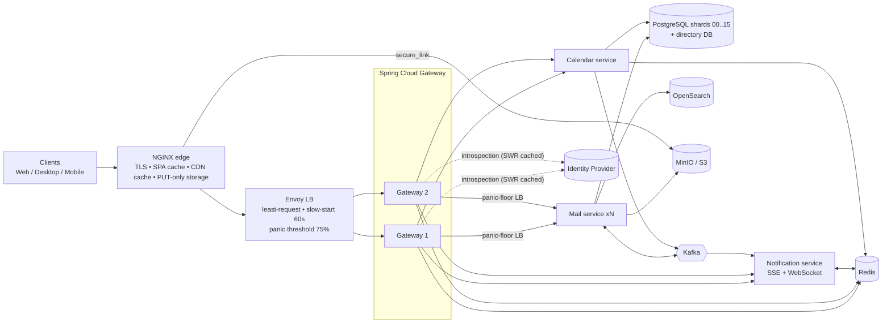
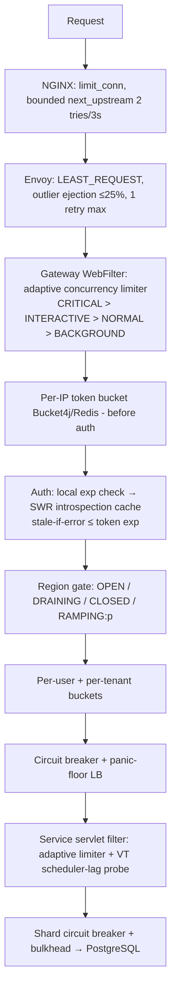
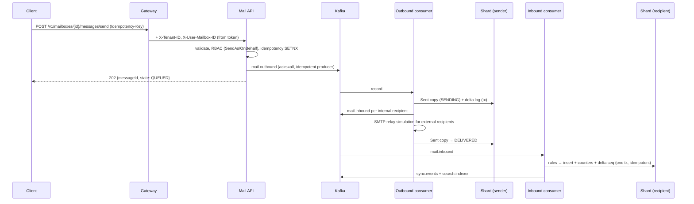
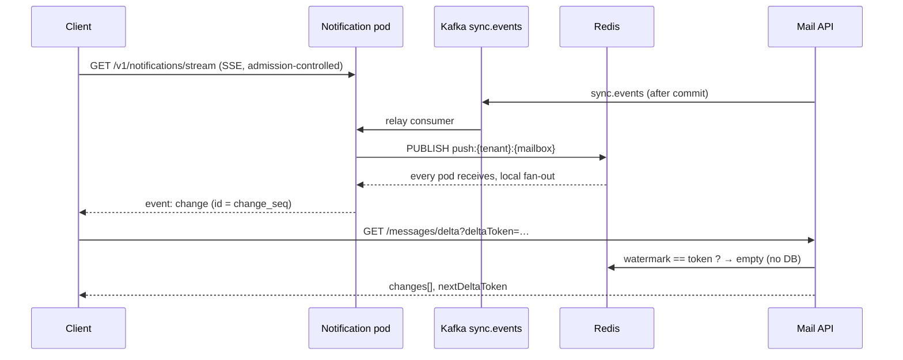

# 01 – High-Level Design

## 1. Goals and constraints
Enterprise e-mail / calendar platform for **millions of mailboxes** across three regions (APAC, EMEA, AMER) that must **degrade gracefully, never cascade**. The design is shaped by the failure pattern of the Nov 12–13 2026 outage: a slow identity/control-plane dependency → handshake failures → clients retry in lock-step → health checks eject pods → survivors overload → pods restart cold → reconnect storm.

| Concern | Decision |
|---|---|
| Runtime | Java 21, Spring Boot 3.4, **virtual threads** (`spring.threads.virtual.enabled=true`) |
| Edge | NGINX (TLS, static SPA immutable caching, signed-URL attachment CDN cache, PUT-only storage ingress) → **Envoy** (least-request, 60 s slow start, panic threshold 75 %) → Spring Cloud Gateway |
| Data | PostgreSQL 16, **16 logical shards** (2 physical hosts here), consistent hashing on `(tenant_id, mailbox_id)`; RANGE(month) → HASH(mailbox) partitioning |
| Async | Kafka (durable, keyed per mailbox), tiered store-and-forward retry, DLQ |
| Cache / coordination | Redis (SWR L2, delta watermarks, idempotency, free/busy bitmaps, gate flags, Pub/Sub), Redisson locks |
| Search | OpenSearch, tenant-routed + mandatory tenant filters |
| Objects | MinIO/S3 via presigned PUT, signed CDN GET |

## 2. Component view

## 3. Request path and resilience layers

### Outage mitigations → implementation map
| Failure mode | Mitigation | Where |
|---|---|---|
| IdP / routing plane slow or down | Stale-while-revalidate + stale-if-error cache (L1 Caffeine, L2 Redis), never beyond token `exp`; fail-fast 503 + `Retry-After` for unseen tokens; 1.5 s upstream timeout | `StaleWhileRevalidateCache`, `TokenValidator`, `TenantRoutingCache` |
| Synchronised retries | Full-jitter exponential backoff everywhere; randomised `Retry-After`; SSE `retry:` hint jittered; reference client policy with initial spread | `JitterBackoff` |
| Health-check ejection cascade | Liveness = JVM only; readiness = local warm-up only; dependency state informational; active probes with hysteresis; **minimum-healthy floor / panic mode** (>25 % unhealthy ⇒ stop ejecting) in Envoy and in the gateway LB | `JvmLivenessIndicator`, `PanicFloorInstanceListSupplier`, `envoy.yaml` |
| Overload | Gradient2/AIMD adaptive concurrency limiter + priority shedding; virtual-thread scheduler-lag probe as congestion signal | `AimdConcurrencyLimiter`, `VirtualThreadLagMonitor` |
| Cold-restart death spiral | Limit ceiling ramps 5 %→100 % over 60 s; Envoy slow-start; readiness warm-up hold; connection admission control on notification pods | limiter, `envoy.yaml`, `ReconnectAdmission` |
| Shard degradation | Per-shard circuit breaker + bulkhead; Kafka store-and-forward (retry tier 1 → tier 2 → DLQ at 48 h) | `ShardExecutor`, `TieredRetryRouter` |
| Regional recovery | Phased region gate (drain / ramp) via Redis flags + admin API | `RegionGateService`, `RegionGateAdminController` |
| Noisy neighbour | Per-tenant token bucket + per-tenant routing keys | `RateLimitFilters` |

## 4. Data flows
### 4.1 Send mail (202 means durable)

Failure at any step publishes a `RetryEnvelope` to `mail.retry.tier1` (attempts 1–3, jitter base 15 s) then `tier2` (base 5 min, cap 30 min), then `mail.dlq` after 48 h. Offsets are acknowledged only after processing **or** durable hand-off to a retry tier.

### 4.2 Delta sync + push

## 5. Capacity estimation (order-of-magnitude, planning numbers)
Assumptions: 5 M mailboxes, 40 received + 10 sent messages/mailbox/day, average stored message 60 KB body+headers (attachments in object storage), 5-year retention, 3× peak/avg.

| Quantity | Estimate |
|---|---|
| Messages/day | 5 M × 50 = **250 M/day** ≈ 2.9 k/s avg, ~9 k/s peak (each = 1 sender copy + n recipient copies) |
| Row storage | 250 M × 60 KB ≈ **15 TB/day raw** → compress (TOAST/lz) ~3× ⇒ ~5 TB/day; this is why bodies > 1 MB and attachments sit in S3 and why retention/archival tiers matter |
| Shards | Target ≤ 4 TB hot data per physical PG host ⇒ start with 16 logical shards × (months of hot data) and re-balance logical→physical without re-hashing |
| Delta log | ~3 changes/message ⇒ 750 M rows/day; retained 30 days (purge by `min_retained_seq`), ~100 B/row ⇒ ~2 TB hot |
| Concurrent SSE | 30 % of 5 M online ⇒ 1.5 M connections ⇒ ~30 notification pods at 50 k conns |
| Kafka | 9 k msg/s peak × ~6 events/message ≈ 55 k events/s; 12–48 partitions per topic |
| Redis | watermarks 5 M × ~100 B; auth cache 1.5 M × ~300 B; free/busy 5 M × 12 B × days |

## 6. Security model
* Gateway authenticates (HS256 local or IdP introspection), **overwrites** `X-Tenant-ID`, `X-User-ID`, `X-User-Mailbox-ID`, `X-Region`; clients cannot spoof them.
* Services enforce mailbox-level RBAC (owner, FullAccess, SendAs, SendOnBehalf).
* Every SQL statement is tenant+mailbox scoped; OpenSearch queries carry mandatory server-side filters + routing.
* Attachments: presigned PUT (15 min), signed CDN GET (10 min, HMAC-style `secure_link`), anonymous GET on the storage ingress is denied.
* Production hardening still required: mTLS between tiers, secrets manager, WAF, network policies, `X-Admin-Key` replaced by real operator authN.

## 7. Known simplifications (explicit)
Single Kafka broker / Redis node / OpenSearch node in compose (use clusters, RF=3, `min.insync.replicas=2`); SMTP relay is simulated; calendar delegation is owner-only; attendee RSVP writes the organizer copy directly rather than via inbound iTIP processing; the NGINX `secure_link` secret is duplicated in `nginx.conf` and `outlook.mail.cdn-secret` and must be templated in real deployments.
