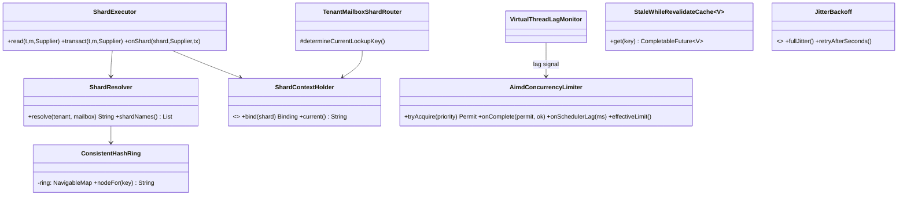
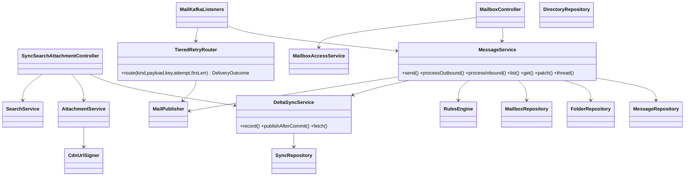
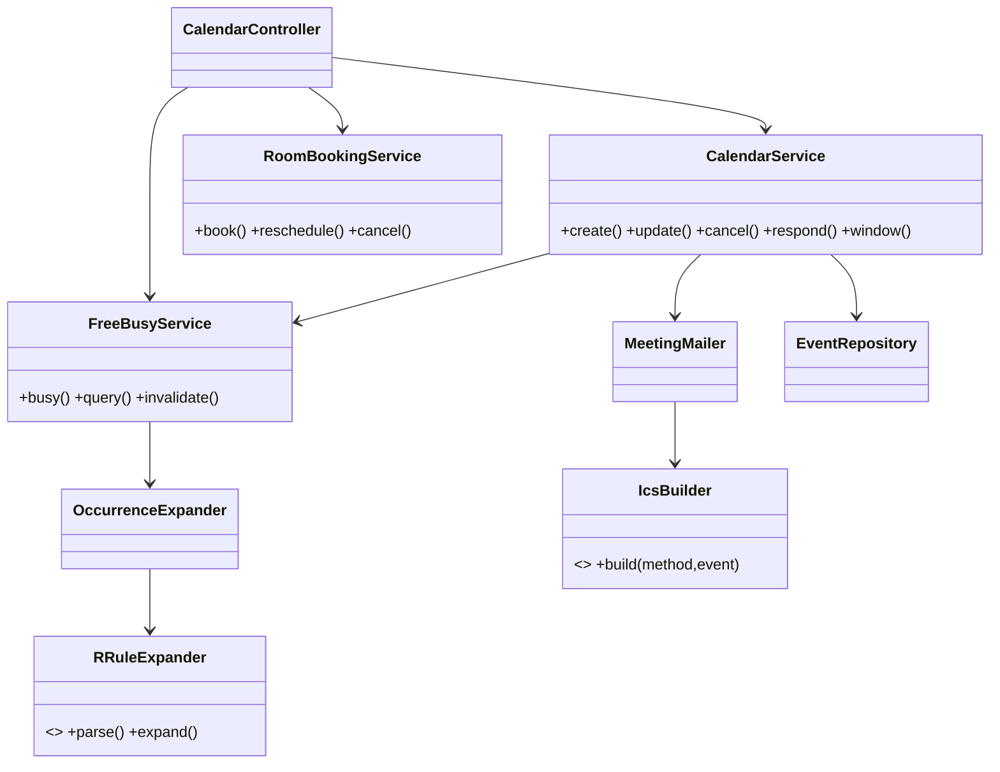
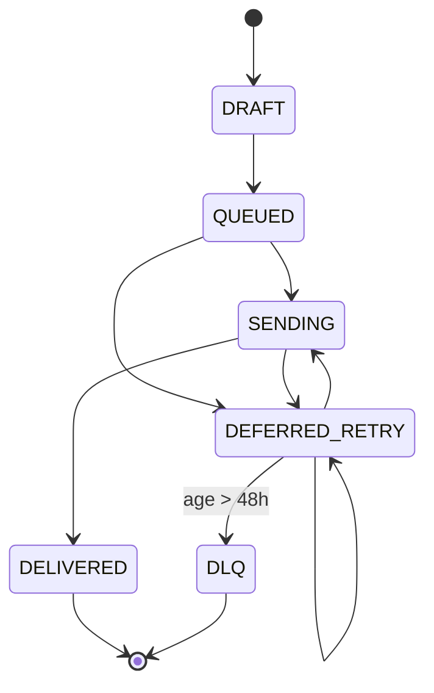
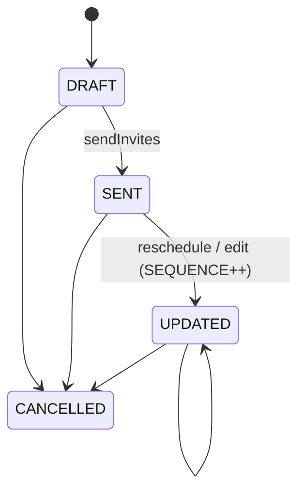

# 02 – Low-Level Design

## 1. Module layout
| Module | Port | Responsibility |
|---|---|---|
| `outlook-common` | – | models, sharding (`ShardResolver`, `TenantMailboxShardRouter`, `ShardExecutor`), resilience (`AimdConcurrencyLimiter`, `StaleWhileRevalidateCache`, `JitterBackoff`, Resilience4j config), health indicators, servlet load-shedding filter, **shard + directory SQL migrations** |
| `outlook-gateway` | 8080 | auth, rate limits, region gate, adaptive shedding (reactive `WebFilter`), panic-floor LB, circuit-breaker fallbacks |
| `outlook-mail-service` | 8081 | mailboxes, folders, messages, send pipeline, delta sync, attachments, search, rules, OOF, delegation, contacts/GAL, tasks |
| `outlook-calendar-service` | 8082 | events, RRULE expansion, meeting lifecycle, ICS, free/busy, room booking |
| `outlook-notification-service` | 8083 | SSE + WebSocket push, Redis Pub/Sub fan-out, reconnect admission control |

## 2. Class diagrams
### 2.1 Sharding and resilience core

`ShardExecutor` = shard binding + per-shard **circuit breaker** + **bulkhead** + optional `TransactionTemplate`. The shard key is thread-bound before the connection is obtained, so `AbstractRoutingDataSource` picks the right pool.

### 2.2 Mail service

### 2.3 Calendar service

## 3. State machines
### 3.1 Delivery (`DeliveryState`)

### 3.2 Meeting (`MeetingStatus`) and attendee response

Attendee response: `NEEDS_ACTION → ACCEPTED | TENTATIVE | DECLINED` (can change again).

## 4. Key algorithms
### 4.1 Keyset pagination in 30-day windows (`MessageRepository.page`)
1. `hi = cursor ? cursor.receivedAt + 1µs : now + 60 s`.
2. For up to 24 windows: query `received_at >= hi-30d AND < hi` with `(received_at, message_id) < (cursor)` and `LIMIT remaining`; append; `hi -= 30d`.
3. Each query has literal tenant/mailbox/folder equality and a bounded `received_at` range ⇒ 1 monthly partition (2 at month boundaries) × **1 hash sub-partition**, Index Only Scan on `idx_mailbox_folder_covering`.
4. Cursor = base64url(`epochMicros:messageId`). No `OFFSET` anywhere.

### 4.2 Adaptive concurrency (`AimdConcurrencyLimiter`)
* success: `gradient = clamp(1.5 · longRtt/shortRtt, 0.5, 1)`, `limit ← 0.8·limit + 0.2·(limit·gradient + √limit)` (only when in-flight ≥ limit/2);
* failure (5xx/shed) or VT scheduler lag > 75 ms: `limit ← 0.9·limit` (multiplicative decrease);
* warm-up ceiling `max × (0.05 + 0.95·t/60 s)`;
* admission: BACKGROUND ≤ 50 % of limit, NORMAL ≤ 80 %, INTERACTIVE ≤ 100 %, CRITICAL always.
Verified in `AimdAndJitterTest` (32 background slots of 64, warm-up 5 %→100 %).

### 4.3 Stale-while-revalidate (`StaleWhileRevalidateCache`)
`[0,fresh)` serve · `[fresh, fresh+swr)` serve + single-flight background refresh · `[…, staleIfError)` serve only if upstream fails · all windows clipped to the value’s hard expiry (token `exp`). L1 Caffeine, L2 Redis (`fresh|swr|err|json`), L2 failures are ignored.

### 4.4 Delta sync
* `change_seq` allocated with `INSERT … ON CONFLICT DO UPDATE SET last_seq = last_seq + 1 RETURNING` inside the business transaction ⇒ row lock ⇒ sequence order equals commit order, no gaps visible to readers.
* After commit: Redis watermark `delta:wm:{t}:{m}` + `sync.events`.
* Fetch: token == watermark ⇒ empty without touching PostgreSQL; token below `min_retained_seq` ⇒ **410 Gone** (full resync); token is `base64url(seq.mac)` bound to tenant+mailbox.

### 4.5 Conversation threading
`conversation_id = UUIDv3(tenant, root)`, root = `References[0]` → `In-Reply-To` → own `Message-ID`. Replies sent through the API copy the parent's conversation id.

### 4.6 RRULE / timezone handling
Expansion runs on local wall-clock in the event’s IANA zone and converts to instants, so 09:00 America/New_York stays 09:00 across the 1 Nov 2026 DST end (13:00Z → 14:00Z). Supports DAILY/WEEKLY/MONTHLY/YEARLY, INTERVAL, COUNT, UNTIL, BYDAY (with ordinals), BYMONTHDAY, BYMONTH, EXDATE. Verified by `RRuleExpanderTest`.

### 4.7 Room booking
Redisson lock `lock:resource:{tenant}:{resource}` → insert; authoritative guard is `EXCLUDE USING gist (tenant_id =, resource_id =, tstzrange(start_at,end_at,'[)') &&) WHERE status='CONFIRMED'`; reschedule uses `version` compare-and-set. Violations map to **409**.

## 5. REST API (via gateway, `Authorization: Bearer …`)
| Method & path | Notes |
|---|---|
| `POST /v1/mailboxes/{m}/messages/send` | `Idempotency-Key`; 202 (200 on replay) |
| `GET /v1/mailboxes/{m}/folders` · `POST …/folders` | counts from counter table |
| `GET /v1/mailboxes/{m}/folders/{f}/messages?limit&cursor&unreadOnly` | keyset |
| `GET/PATCH /v1/mailboxes/{m}/messages/{id}` · `GET …/thread` | PATCH is optimistic (409 on race) |
| `GET /v1/mailboxes/{m}/messages/delta?deltaToken&limit` | 410 when token expired |
| `GET /v1/mailboxes/{m}/search?q=` | OpenSearch |
| `POST …/attachments/upload-url` · `POST …/attachments/{id}/complete` · `GET …/attachments/{id}/download-url` | presigned PUT / signed CDN GET |
| `PUT/DELETE …/delegates` · `POST …/rules` · `PUT …/settings/oof` · `POST/GET …/contacts` · `GET …/tasks` | |
| `GET /v1/directory/gal?q=` | prefix then trigram fuzzy |
| `POST /v1/admin/mailboxes` | provisioning (idempotent) |
| `POST/GET/PUT …/events…`, `POST …/events/{id}/cancel|respond` | calendar |
| `POST /v1/freebusy` | multi-mailbox, common free slots |
| `POST /v1/resources` · `POST …/{id}/book` · `PUT/DELETE …/bookings/{b}` | rooms |
| `GET /v1/notifications/stream?mailboxId=` · `WS /ws/v1/notifications?mailboxId=` | push |
| `PUT /gateway-admin/regions/{R}` · `POST …/ramp` · `GET …/regions` | `X-Admin-Key` |

Overload contract: `503` (+`Retry-After` random 2–20 s, `X-Shed-Reason`), `429` (+`Retry-After`, `X-RateLimit-Scope`), `410` delta expired, `409` optimistic conflicts.

## 6. Kafka topics
| Topic | Key | Producer → Consumer |
|---|---|---|
| `mail.outbound` | `tenant:senderMailbox` | API/Calendar → outbound processor |
| `mail.inbound` | `tenant:recipientMailbox` | outbound processor → inbound processor |
| `mail.retry.tier1/tier2` | original key | router → retry consumer (honours `notBefore` via `nack(Duration)`) |
| `mail.dlq` | original key | router (age > 48 h) |
| `sync.events` | `tenant:mailbox` | mail/calendar → notification relay |
| `search.indexer` | `tenant:mailbox` | inbound processor → OpenSearch indexer |

## 7. Testing
`AimdAndJitterTest`, `RRuleExpanderTest` (pure), `PartitionPruningIT` (Testcontainers PostgreSQL: asserts Index Only Scan, no Seq Scan, single hash sub-partition), `RateLimiterServiceIT` (Testcontainers Redis: shared burst across two gateway instances), and `infrastructure/chaos-test/simulate_nov2026_outage.py` for IdP-degradation, reconnect-storm and region-drain scenarios against the running stack.
